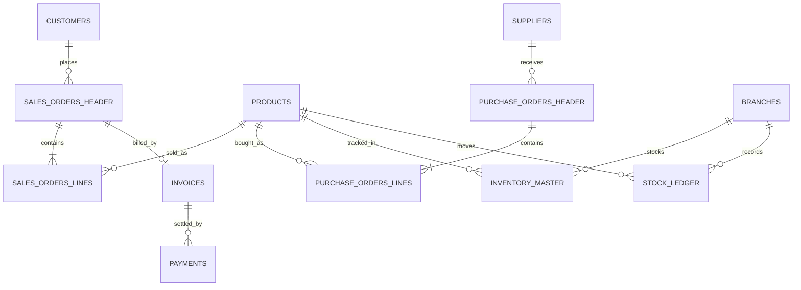

<div align="center">


<br/>


</div>

---

## Contents

Click a section to jump to it. Each week is collapsible.

- [About the project](#about-the-project) · [Dataset](#dataset-at-a-glance) · [Data model](#data-model)
- [Roadmap](#roadmap)
- [Week 1](#week-1) · [Week 2](#week-2) · [Week 3](#week-3) · [Week 4](#week-4) · [Week 5](#week-5)
- [KPIs](#key-kpis) · [Quick start](#quick-start) · [Repository](#repository-structure)

## About the project

A 12-week applied data project on heavy-equipment supply-chain data. The goal is to **reduce dead stock, prevent stockouts, and improve supplier reliability** across six warehouses.

The project covers supplier performance, inventory optimisation, warehouse operations, and demand forecasting.

## Dataset at a glance

<div align="center">

</div>

| Item | Value |
|---|---|
| Time period | 2019 – 2024 |
| Customers | 500 |
| Suppliers | 8 |
| Products (SKUs) | 30 |
| Warehouses (branches) | 6 |
| Purchase orders | 24,000 |

<div align="center">

</div>

> **Data note:** 2,370 purchase orders (9.9%) have no received date yet. They are flagged as *pending* and left blank, not filled in. The validation checks are recorded in `week-01/docs/validation_log.csv` and `week-02/docs/validation_checks.csv`.

<div align="center">

</div>

## Data model



## Roadmap

<div align="center">

</div>

- [x] Week 1 — Dataset exploration and exploratory data analysis (submitted)
- [ ] Week 2 — Data cleaning and missing-value treatment (ready to submit)
- [x] Week 3 — SQL database design and data validation (built; SQL Server run pending)
- [x] Week 4 — Product performance and stock health (complete; overstock result pending verification)
- [x] Week 5 — Inventory turnover, stock aging, and branch analysis (complete; aging is approximate)
- [ ] Week 6 — Warehouse space utilisation and throughput
- [ ] Week 7 — Supplier and customer analytics
- [ ] Week 8 — Demand forecasting
- [ ] Week 9 — Inventory optimisation models *(on hold: stock unit to be confirmed)*
- [ ] Week 10 — KPI dashboard development in Power BI
- [ ] Week 11 — Model evaluation and business recommendations
- [ ] Week 12 — Final report, documentation, and deployment

<a id="week-1"></a>
<details open>
<summary><h2 style="display:inline">Week 1: Dataset exploration</h2></summary>


### Team
| Name | Role | Ownership (from Week 2 onward) |
|---|---|---|
| Harsh Pandey | Analyst / Scrum Master (Week 1) | Inventory and warehouse |
| Harsh Pandey | Analyst | Supplier and customer |
| Harsh Pandey | Data scientist | Forecasting and risk models |

### Week 1 delivered
- Profiling of all 12 source tables (row counts, nulls, duplicates, primary keys)
- Relationship checks: 16 joins, orphan keys counted
- Cleaning and validation log
- Inventory reconciliation: opening stock + IN − OUT vs current stock
- KPI definitions (10) and analysis questions (10) in `week-01/week-01-eda.ipynb`, section 9
- Draft data dictionary for the 12 source tables

### Key findings (from the real data run)
- 2,370 of 24,000 purchase orders (9.9%) are pending, with no received date.
- 393 invoice rows share 197 invoice IDs, so their payments cannot be matched to a single invoice. 403 payment rows also share payment IDs. Both are excluded from payment measures and listed in the validation log.
- Stock reconciles within 1% for all 180 product-branch pairs, but only 1 matches exactly (median gap 66 units). Current stock is 88,853 to 121,013 units per pair while the largest ledger movement is 300, so the unit of measure needs confirming with CadetX.

### Open items
- Data dictionary descriptions (fill from *Fields Documentation.docx*)
- Confirm business rules: excluded order statuses, payment-to-invoice link
- Decide action on each flagged check in the validation log

### Week 1 outputs

| File | What it contains |
|---|---|
| `docs/table_summary.csv` | Row counts, duplicates, nulls and primary-key checks for all 12 tables |
| `docs/relationship_checks.csv` | 16 join checks with orphan-key counts |
| `docs/validation_log.csv` | Data-quality checks with rows failed and the proposed action |
| `docs/cleaning_log.csv` | Every cleaning change, with rows affected |
| `docs/data_dictionary.csv` | Column-level dictionary for the 12 source tables |

</details>

<a id="week-2"></a>
<details open>
<summary><h2 style="display:inline">Week 2: Cleaning and integration</h2></summary>


### Summary
Week 2 cleans the 12 source tables, handles the one column with missing values, checks the cleaned data, and builds one analytical dataset with one row per product and branch (180 rows, 18 columns).

### Missing values
The only column with blanks is `purchase_orders.received_date`: 2,370 blank cells, all for pending purchase orders. The blanks are kept, not filled in, and pending orders are excluded from delivery and lead-time measures.

### Cleaning rules applied in code
- Extra spaces removed from text; dates converted to real dates (no failures).
- Branch capacity text such as `45230 sqft` converted to a number, with the unit kept in its own column (6 of 6 converted).
- Invoice IDs and payment IDs shared by more than one record are flagged and kept (393 and 403 rows).
- ADJUSTMENT stock movements (2,454 rows) have no direction in the source, so they are excluded from stock checks.

### Validation
25 of 25 checks pass: no rows lost, unique product, branch, order and customer IDs, no missing links between tables, and sales order totals match their lines.

### Analytical dataset
One row per product and branch (180 rows). Main measures:
- **Average monthly units** over the last 12 months (KPI orders only; Cancelled and Returned are excluded).
- **Days of stock**: current stock divided by daily demand over the last 90 days.
- **Actual lead time**: median 17.9 days from order to receipt, against a quoted median of 18 days.

### Open flag: stock quantities
Current stock is about 1,173 months of average demand (median days of stock 52,625). Demand is consistent: ledger OUT movements match KPI sales within 2%. The problem is the stock side, so days of stock, stock value, reorder flags and stockout flags are **not reliable** until CadetX confirms the unit.

### Week 2 outputs

| File | What it contains |
|---|---|
| `week-02-cleaning.ipynb` | Simplified notebook: 9 steps, 25 checks |
| `data-cleaned/analytical_dataset.csv` | 180-row analytical dataset, 18 columns |
| `docs/cleaning_log.csv` | Every cleaning change, with rows affected |
| `docs/validation_checks.csv` | The 25 validation checks and their results |
| `docs/open_flags.csv` | Known problems that block some measures |
| `docs/analytical_dataset_dictionary.csv` | Definition and status for each of the 18 columns (draft) |

</details>

<a id="week-3"></a>
<details open>
<summary><h2 style="display:inline">Week 3: SQL database design and validation</h2></summary>


- Database schema for SQL Server: 12 tables with primary keys, foreign keys and checks (`week-03/sql/01_schema.sql`).
- Keys reflect the Week 1 findings: invoices are keyed on (invoice_id, so_id) and payments on (payment_id, invoice_id), because the single IDs are shared.
- Loader that loads the CSVs in dependency order and checks row counts (`week-03/python/load_to_sql.py`).
- 13 validation queries, each returning PASS or FLAG (`week-03/sql/02_validation.sql`). Results match the Week 1 and Week 2 numbers.
- Tested on SQLite; SQL Server run pending.

</details>

<a id="week-4"></a>
<details open>
<summary><h2 style="display:inline">Week 4: Product performance and stock health</h2></summary>


### Summary
Week 4 measures how revenue, sales volume, and stock are spread across the 30 products, then classifies each product by how fast it moves and how much stock it holds.

### Results
- **Sales period:** 1 January 2019 to 31 December 2024 (2,192 days).
- **Products with sales:** 30 of 30.
- **Revenue:** 25,447,392,560, at a gross margin of 21.6%.
- **Concentration:** 10 products (33% of the range) generate 80% of revenue.
- **Dead stock:** none. Every product sold during the period.
- **Overstock:** all 30 products are flagged at more than 90 days of cover. **This result is pending verification** (see below).

### Open flag: overstock
The stock total is consistent with the ledger (see Week 5), but every product showing 30,000+ days of cover is not yet confirmed as a real business finding. It needs checking against sales volume before it is reported.

### Week 4 outputs

| File | What it contains |
|---|---|
| `week-04/week04_analysis.py` | Day 1: load, profile, check joins |
| `week-04/week04_day2.py` | Day 2: product performance (B1) |
| `week-04/week04_day3.py` | Day 3: fast and slow movers, dead stock (B2, B3) |
| `week-04/week04_day4.py` | Day 4: turnover and stock health (B4, B5) |
| `week-04/week04_day5.py` | Day 5: charts and KPI summary |
| `week-04/results.md` | Results summary for each analysis |
| `week-04/README.md` | Method, results, and limitations |

</details>

<a id="week-5"></a>
<details open>
<summary><h2 style="display:inline">Week 5: Inventory turnover, stock aging, and branch analysis</h2></summary>


### Summary
Week 5 replaces the Week 4 snapshot turnover with a month-end average, measures how old the stock on hand is, and compares turnover across branches and categories.

### Results
- **Turnover (average basis):** 0.14x, equal to 15,454 days of inventory. This replaces the Week 4 snapshot figure of 0.07x.
- **Branch turnover:** ranges from 0.11x at HYD001 to 0.17x at KOL001 and CHN001. Each branch holds about 22 to 24 billion in average stock, but sales differ widely.
- **Category turnover:** all 15 categories fall between 0.13x and 0.15x.
- **Stock age (approximate):** 81% of stock value on hand is over 365 days old.

<div align="center">

<br/>

</div>

### Data checks
- The stock ledger reconciles with current stock: total difference of 1,526 units (0.008%), with 166 of 180 product-branch pairs matching exactly.
- About 20% of IN and OUT ledger rows (around 55,000) do not match their recorded quantity against the balance change. These are spread evenly across 2019 to 2024, and about 11,300 cannot be explained by same-day ordering.
- The ledger runs to 28 January 2025, past the 2024-12-31 sales period. The turnover calculation uses the sales period only.

### Open flag: aging accuracy
Because of the ledger inconsistencies above, the aging percentages are estimates. The direction (most stock is old) is reliable. The exact shares should not be used for write-down decisions until the ledger ordering is confirmed with the data owner.

### Week 5 outputs

| File | What it contains |
|---|---|
| `week-05/README.md` | Method, results, limitations, and next steps |
| `week-05/results.md` | Results summary for each analysis |
| `week-05/output/week5_turnover_by_product_corrected.csv` | Turnover and days of inventory per product |
| `week-05/output/week5_turnover_by_branch.csv` | Turnover per branch |
| `week-05/output/week5_turnover_by_category_corrected.csv` | Turnover per category |
| `week-05/output/week5_aging_buckets.csv` | Stock value by age bucket |
| `week-05/output/week5_aging_by_product.csv` | Average and oldest lot age per product |
| `week-05/output/week5_kpis.csv` | KPI summary |

</details>

<a id="key-kpis"></a>
## Key KPIs

KPIs are calculated from validated source data. No unverified results are reported.

| Area | KPIs |
|---|---|
| Supplier | On-time delivery rate · Fulfilment rate · Average lead time · Defect rate · Reliability score |
| Inventory | Turnover ratio · Days of inventory on hand · Stockout rate · Dead-stock value · Carrying cost · Reorder-point accuracy |
| Warehouse | Fulfilment rate · Order cycle time · Backorder rate · Branch utilisation · Fill rate |
| Finance | Outstanding invoice value · Days sales outstanding · Purchase-order ageing |
| Forecasting | Forecast accuracy |

## Models to build

- Demand forecasting (statistical and machine-learning methods)
- Supplier reliability scoring
- Inventory segmentation using ABC analysis
- Reorder-point and safety-stock estimation
- Stockout risk prediction
- Dead-stock identification
- Inventory optimisation recommendations

## Quick start

**1. Clone the repository**

```bash
git clone https://github.com/HARSHPANDEY9756/cadetx-warehouse-analytics.git
cd cadetx-warehouse-analytics
```

**2. Create a virtual environment**

```bash
python -m venv .venv
```

Windows PowerShell:

```powershell
.\.venv\Scripts\Activate.ps1
```

**3. Install dependencies**

```bash
python -m pip install --upgrade pip
pip install pandas numpy scikit-learn statsmodels matplotlib seaborn jupyter sqlalchemy
```

**4. Explore and clean the dataset**

Put the 12 source CSVs in `data/raw/` first. Then open a notebook:

```bash
jupyter notebook week-01/week-01-eda.ipynb
jupyter notebook week-02/week-02-cleaning.ipynb
```

Outputs are written to `data/cleaned/` and `docs/` inside each week's folder.

**5. Run the SQL database (Week 3)**

Run `week-03/sql/01_schema.sql` in SSMS, then:

```bash
python week-03/python/load_to_sql.py --csv-dir data/raw --url "mssql+pyodbc://localhost/CadetX?driver=ODBC+Driver+18+for+SQL+Server&trusted_connection=yes&TrustServerCertificate=yes"
```

Then run `week-03/sql/02_validation.sql` in SSMS.

**6. Run the Week 4 and Week 5 analysis**

Week 4 and Week 5 were run in Google Colab. Each week's README lists the run order. The scripts in `week-04/` run locally with the CSVs in `data/`.

**Prerequisites:** Python 3.8 or later, the project dataset (download from the CadetX portal), and, for Week 3, SQL Server with the ODBC Driver 18.

## Technology stack

| Category | Tools |
|---|---|
| Programming | Python |
| Data analysis | Pandas, NumPy |
| Machine learning | Scikit-learn, Statsmodels |
| Visualisation | Matplotlib, Seaborn, Power BI |
| Database | SQL Server, T-SQL, SQLAlchemy |
| Development | Jupyter Notebook, Google Colab |
| Version control | Git, GitHub |

## Repository structure

```
cadetx-warehouse-analytics/
├── assets/                    # SVG charts and metrics.json (used by this README)
├── data/
│   ├── raw/                   # the 12 source CSVs (not committed)
│   └── cleaned/               # generated outputs (not committed)
├── week-01/                   # Week 1: notebook, README, sprint notes, docs
├── week-02/                   # Week 2: notebook, README, sprint notes, docs, data-cleaned
├── week-03/                   # Week 3: SQL schema, validation, loader
│   ├── sql/
│   └── python/
├── week-04/                   # Week 4: product performance and stock health
├── week-05/                   # Week 5: turnover, aging, and branch analysis
├── sprint-notes/              # Scrum Master sprint notes for each CadetX week
├── .gitignore
└── README.md
```

## Project progress

Progress is tracked in the roadmap above and in the chart at the top of that section. Add validated charts, model results, and Power BI screenshots as the project develops.

## Author

**Harsh Pandey** — Data Science Analyst

- GitHub: [github.com/harshpandey97](https://github.com/harshpandey97)
- LinkedIn: [linkedin.com/in/harsh-pandey-395a10237](https://www.linkedin.com/in/harsh-pandey-395a10237)
- Email: harshpandey6012@gmail.com

## License

Released under the MIT License. Add a `LICENSE` file to the repository to make this official.
