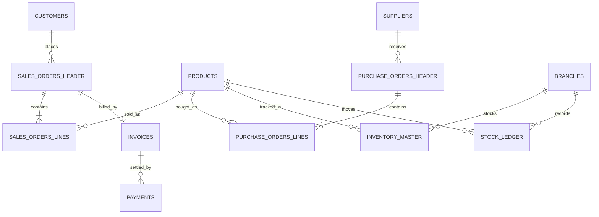

<div align="center">


<br/>


</div>

---

## About the project

A 12-week applied data project on heavy-equipment supply-chain data. The goal is to **reduce dead stock, prevent stockouts, and improve supplier reliability** across six warehouses.

The project covers supplier performance, inventory optimisation, warehouse operations, and demand forecasting.

## Dataset at a glance

<div align="center">

</div>

| Item | Value |
|---|---|
| Time period | 2019 – 2024 |
| Customers | 500 |
| Suppliers | 8 |
| Products (SKUs) | 30 |
| Warehouses (branches) | 6 |
| Purchase orders | 24,000 |

<div align="center">

</div>

> **Data note:** 2,370 purchase orders (9.9%) have no received date yet. They are flagged as *pending* and left blank, not filled in. The validation checks are recorded in `week-01/docs/validation_log.csv` and `week-02/docs/validation_checks.csv`.

<div align="center">

</div>

## Data model



## Roadmap

<div align="center">

</div>

- [x] Week 1 — Dataset exploration and exploratory data analysis (submitted)
- [ ] Week 2 — Data cleaning and missing-value treatment (ready to submit)
- [x] Week 3 — SQL database design and data validation (built; SQL Server run pending)
- [ ] Week 4 — Supplier performance analysis
- [ ] Week 5 — Inventory health and dead-stock analysis *(on hold: stock unit to be confirmed)*
- [ ] Week 6 — Stockout and replenishment analysis *(on hold: stock unit to be confirmed)*
- [ ] Week 7 — Warehouse performance comparison
- [ ] Week 8 — Demand forecasting
- [ ] Week 9 — Inventory optimisation models *(on hold: stock unit to be confirmed)*
- [ ] Week 10 — KPI dashboard development in Power BI
- [ ] Week 11 — Model evaluation and business recommendations
- [ ] Week 12 — Final report, documentation, and deployment

## Week 1: Dataset exploration

### Team
| Name | Role | Ownership (from Week 2 onward) |
|---|---|---|
| Harsh Pandey | Analyst / Scrum Master (Week 1) | Inventory and warehouse |
| Harsh Pandey | Analyst | Supplier and customer |
| Harsh Pandey | Data scientist | Forecasting and risk models |

### Week 1 delivered
- Profiling of all 12 source tables (row counts, nulls, duplicates, primary keys)
- Relationship checks: 16 joins, orphan keys counted
- Cleaning and validation log
- Inventory reconciliation: opening stock + IN − OUT vs current stock
- KPI definitions (10) and analysis questions (10) in `week-01/week-01-eda.ipynb`, section 9
- Draft data dictionary for the 12 source tables

### Key findings (from the real data run)
- 2,370 of 24,000 purchase orders (9.9%) are pending, with no received date.
- 393 invoice rows share 197 invoice IDs, so their payments cannot be matched to a single invoice. 403 payment rows also share payment IDs. Both are excluded from payment measures and listed in the validation log.
- Stock reconciles within 1% for all 180 product-branch pairs, but only 1 matches exactly (median gap 66 units). Current stock is 88,853 to 121,013 units per pair while the largest ledger movement is 300, so the unit of measure needs confirming with CadetX.

### Open items
- Data dictionary descriptions (fill from *Fields Documentation.docx*)
- Confirm business rules: excluded order statuses, payment-to-invoice link
- Decide action on each flagged check in the validation log

### Week 1 outputs

| File | What it contains |
|---|---|
| `docs/table_summary.csv` | Row counts, duplicates, nulls and primary-key checks for all 12 tables |
| `docs/relationship_checks.csv` | 16 join checks with orphan-key counts |
| `docs/validation_log.csv` | Data-quality checks with rows failed and the proposed action |
| `docs/cleaning_log.csv` | Every cleaning change, with rows affected |
| `docs/data_dictionary.csv` | Column-level dictionary for the 12 source tables |

## Week 2: Cleaning and integration

### Summary
Week 2 cleans the 12 source tables, handles the one column with missing values, checks the cleaned data, and builds one analytical dataset with one row per product and branch (180 rows, 18 columns).

### Missing values
The only column with blanks is `purchase_orders.received_date`: 2,370 blank cells, all for pending purchase orders. The blanks are kept, not filled in, and pending orders are excluded from delivery and lead-time measures.

### Cleaning rules applied in code
- Extra spaces removed from text; dates converted to real dates (no failures).
- Branch capacity text such as `45230 sqft` converted to a number, with the unit kept in its own column (6 of 6 converted).
- Invoice IDs and payment IDs shared by more than one record are flagged and kept (393 and 403 rows).
- ADJUSTMENT stock movements (2,454 rows) have no direction in the source, so they are excluded from stock checks.

### Validation
25 of 25 checks pass: no rows lost, unique product, branch, order and customer IDs, no missing links between tables, and sales order totals match their lines.

### Analytical dataset
One row per product and branch (180 rows). Main measures:
- **Average monthly units** over the last 12 months (KPI orders only; Cancelled and Returned are excluded).
- **Days of stock**: current stock divided by daily demand over the last 90 days.
- **Actual lead time**: median 17.9 days from order to receipt, against a quoted median of 18 days.

### Open flag: stock quantities
Current stock is about 1,173 months of average demand (median days of stock 52,625). Demand is consistent: ledger OUT movements match KPI sales within 2%. The problem is the stock side, so days of stock, stock value, reorder flags and stockout flags are **not reliable** until CadetX confirms the unit.

### Week 2 outputs

| File | What it contains |
|---|---|
| `week-02-cleaning.ipynb` | Simplified notebook: 9 steps, 25 checks |
| `data-cleaned/analytical_dataset.csv` | 180-row analytical dataset, 18 columns |
| `docs/cleaning_log.csv` | Every cleaning change, with rows affected |
| `docs/validation_checks.csv` | The 25 validation checks and their results |
| `docs/open_flags.csv` | Known problems that block some measures |
| `docs/analytical_dataset_dictionary.csv` | Definition and status for each of the 18 columns (draft) |

## Week 3: SQL database design and validation

- Database schema for SQL Server: 12 tables with primary keys, foreign keys and checks (`week-03/sql/01_schema.sql`).
- Keys reflect the Week 1 findings: invoices are keyed on (invoice_id, so_id) and payments on (payment_id, invoice_id), because the single IDs are shared.
- Loader that loads the CSVs in dependency order and checks row counts (`week-03/python/load_to_sql.py`).
- 13 validation queries, each returning PASS or FLAG (`week-03/sql/02_validation.sql`). Results match the Week 1 and Week 2 numbers.
- Tested on SQLite; SQL Server run pending.

## Key KPIs

KPIs are calculated from validated source data. No unverified results are reported.

| Area | KPIs |
|---|---|
| Supplier | On-time delivery rate · Fulfilment rate · Average lead time · Defect rate · Reliability score |
| Inventory | Turnover ratio · Days of inventory on hand · Stockout rate · Dead-stock value · Carrying cost · Reorder-point accuracy |
| Warehouse | Fulfilment rate · Order cycle time · Backorder rate · Branch utilisation · Fill rate |
| Finance | Outstanding invoice value · Days sales outstanding · Purchase-order ageing |
| Forecasting | Forecast accuracy |

## Models to build

- Demand forecasting (statistical and machine-learning methods)
- Supplier reliability scoring
- Inventory segmentation using ABC analysis
- Reorder-point and safety-stock estimation
- Stockout risk prediction
- Dead-stock identification
- Inventory optimisation recommendations

## Quick start

**1. Clone the repository**

```bash
git clone https://github.com/HARSHPANDEY9756/cadetx-warehouse-analytics.git
cd cadetx-warehouse-analytics
```

**2. Create a virtual environment**

```bash
python -m venv .venv
```

Windows PowerShell:

```powershell
.\.venv\Scripts\Activate.ps1
```

**3. Install dependencies**

```bash
python -m pip install --upgrade pip
pip install pandas numpy scikit-learn statsmodels matplotlib seaborn jupyter sqlalchemy
```

**4. Explore and clean the dataset**

Put the 12 source CSVs in `data/raw/` first. Then open a notebook:

```bash
jupyter notebook week-01/week-01-eda.ipynb
jupyter notebook week-02/week-02-cleaning.ipynb
```

Outputs are written to `data/cleaned/` and `docs/` inside each week's folder.

**5. Run the SQL database (Week 3)**

Run `week-03/sql/01_schema.sql` in SSMS, then:

```bash
python week-03/python/load_to_sql.py --csv-dir data/raw --url "mssql+pyodbc://localhost/CadetX?driver=ODBC+Driver+18+for+SQL+Server&trusted_connection=yes&TrustServerCertificate=yes"
```

Then run `week-03/sql/02_validation.sql` in SSMS.

**Prerequisites:** Python 3.8 or later, the project dataset (download from the CadetX portal), and, for Week 3, SQL Server with the ODBC Driver 18.

## Technology stack

| Category | Tools |
|---|---|
| Programming | Python |
| Data analysis | Pandas, NumPy |
| Machine learning | Scikit-learn, Statsmodels |
| Visualisation | Matplotlib, Seaborn, Power BI |
| Database | SQL Server, T-SQL, SQLAlchemy |
| Development | Jupyter Notebook, Google Colab |
| Version control | Git, GitHub |

## Repository structure

```
cadetx-warehouse-analytics/
├── assets/                    # SVG charts and metrics.json (used by this README)
├── data/
│   ├── raw/                   # the 12 source CSVs (not committed)
│   └── cleaned/               # generated outputs (not committed)
├── week-01/                   # Week 1: notebook, README, sprint notes, docs
├── week-02/                   # Week 2: notebook, README, sprint notes, docs, data-cleaned
├── week-03/                   # Week 3: SQL schema, validation, loader
│   ├── sql/
│   └── python/
├── .gitignore
└── README.md
```

## Project progress

Progress is tracked in the roadmap above and in the chart at the top of that section. Add validated charts, model results, and Power BI screenshots as the project develops.

## Author

**Harsh Pandey** — Data Science Analyst

- GitHub: [github.com/harshpandey97](https://github.com/harshpandey97)
- LinkedIn: [linkedin.com/in/harsh-pandey-395a10237](https://www.linkedin.com/in/harsh-pandey-395a10237)
- Email: harshpandey6012@gmail.com

## License

Released under the MIT License. Add a `LICENSE` file to the repository to make this official.
